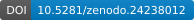
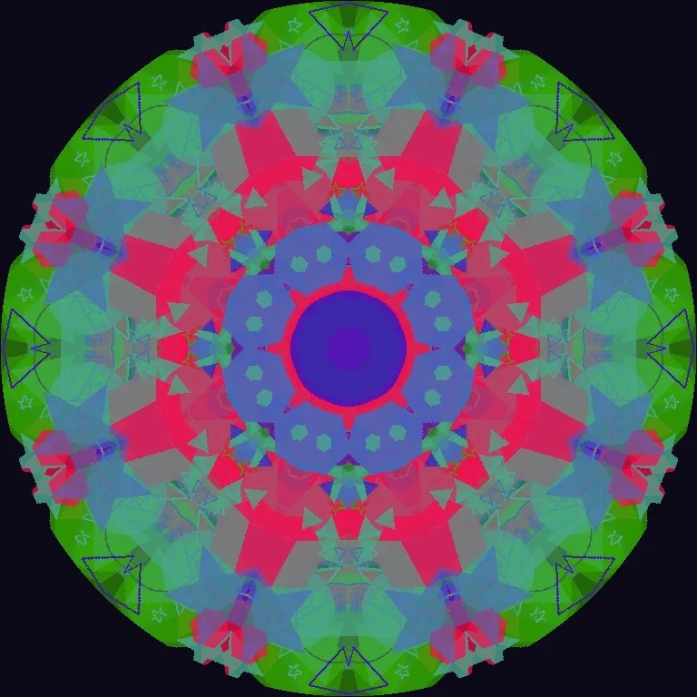
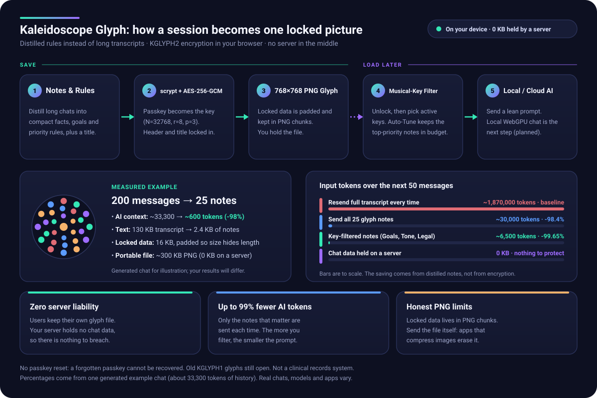

# Project Kaleidoscope (KVMS-1.0)
## A Universal, High-Density Visual Data Standard for Offline AI Context Restoration 

<a href="https://doi.org/10.5281/zenodo.24238012"></a>

**Try it now, no install:** [Vault 3 (Kaleidoscope Glyph)](https://kvm-labs.github.io/vault/) · [All vaults](https://kvm-labs.github.io/vaults/) · [Project website](https://kvm-labs.github.io/)

**Kaleidoscope Glyph** by KVM Labs is a free, private tool that saves your AI chat memory as an encrypted picture (a "Memory Glyph") on your own device, so you can resume the conversation later with any AI. Nothing is uploaded. Keywords: AI memory, AI context, save chat state, encrypted image, offline, local-first, privacy.

Project Kaleidoscope is a privacy-first, zero-cloud browser extension engineered to establish a universal standard for cross-browser human-AI interaction. It eliminates AI context-loss and reduces cloud data-center server strains by allowing users to compress, locally encrypt (AES-256-GCM), and render deep AI chat histories into a highly compact visual image file (a "Memory Glyph") that resembles abstract art. 

<p align="center">
  
  <br />
  <em>Sample 512×512 Encrypted Memory Glyph (KVMS-1.0)</em>
</p>

When a user drops their 50KB custom PNG back into a fresh, blank multimodal AI interface, the universal browser extension aligns the visual matrix, prompts for a passkey PIN, and instantly rehydrates the AI's cognitive context offline.

---

## 🎨 The 3-Axis Visual Data Layer Multiplexing Architecture (planned design, not built yet)
> **Status:** this section describes a future design for storing data directly in shapes, positions and colors. It is **not** how the current version works. Today the text is encrypted and hidden inside the PNG file itself (see `WHITEPAPER.md` section 2 and the format guides in `docs/`), and the picture is decoration generated from the encrypted data.

Unlike fragile high-density matrix grids, Kaleidoscope utilizes distinct, high-contrast geometric paths rendered across a fixed 512x512 canvas coordinate matrix:
1. **Axis A - Geometric Shape Vector (Intent):** Different shape structures (Triangles, Squares, Circles, Pentagons) categorize instruction types, system rules, and data schemas.
2. **Axis B - Spatial Positioning (Context Map):** Exact X,Y pixel coordinates map chronological priorities and conceptual dependency vectors with a strict (0,0) origin point.
3. **Axis C - Color Multiplexing (Variables):** Standard Red (Tech Stack), Green (Progress Completion), and Blue (Security Access Flags) RGB channels act as direct bit-multipliers to encode background variables.

---

## 🆕 Kaleidoscope Glyph (KGLYPH2): the easiest way to try it

No extension needed. Open [`web-vault/kaleidoscope-glyph/glyph.html`](web-vault/kaleidoscope-glyph/glyph.html) in a browser (works offline), or run the Python version. Notes are locked with scrypt + AES-256-GCM into a PNG; only a date and short ID are visible. See the [tool README](web-vault/kaleidoscope-glyph/README.md) and [format spec](docs/SPEC-kglyph2.md).

<p align="center"></p>

> **Less data held, lower AI cost per message, and nothing for the server to protect.** In an illustrative generated chat, sending filtered notes instead of the full history cut input tokens by about 99% (details in the whitepaper, Section 2.5). Limits: no passkey recovery, re-saving the PNG can erase the notes, and it has not been reviewed for healthcare use.

---

## 📂 Project Repository Directory Tree
This is how the repository is organized. To try the extension you only need the `extension/` folder:

```text
Project-Kaleidoscope-KVMS-1.0/
├── README.md                <- this file
├── LICENSE                  <- MIT license text
├── WHITEPAPER.md            <- the research paper (ideas, design, security model)
├── extension/               <- the browser extension (load THIS folder)
│   ├── manifest.json
│   ├── icons/
│   │   ├── kaleidoscope_16.png
│   │   ├── kaleidoscope_48.png
│   │   └── kaleidoscope_128.png
│   ├── background/
│   │   └── worker.js
│   ├── scripts/
│   │   └── content_scraper.js
│   └── ui/
│       ├── popup.html
│       ├── popup.js
│       └── canvas_renderer.html
├── web-vault/               <- two working pages (open index.html in a browser)
│   ├── README.md
│   ├── glyph-forge/
│   │   └── index.html       <- save notes as a flower glyph, restore them as an AI prompt
│   ├── pixel-vault/
│   │   └── index.html       <- lock any text into a picture's pixels
│   └── kaleidoscope-glyph/  <- KGLYPH2 tool: glyph.html (Simple Mode) + glyph.py
└── docs/
    ├── README.md            <- guide to the documents below
    ├── SPEC-glyph-forge.md  <- the Glyph Forge file format as it works today
    ├── SPEC-pixel-vault.md  <- the Pixel Vault file format as it works today
    ├── (concept documents: pitch, proposal, case study, blueprints)
    └── archive/             <- older copies kept for reference
```

---

## 🛠️ Universal Local Installation & Setup Guide

To load and test this prototype extension locally inside your preferred modern web browser, follow the corresponding pipeline steps:

### For Chromium Browsers (Google Chrome, Brave, Microsoft Edge, Opera)
1. Open your browser and navigate to the extensions management console:
   * **Chrome:** `chrome://extensions`
   * **Brave:** `brave://extensions`
   * **Edge:** `edge://extensions`
2. Toggle the **Developer Mode** switch in the top-right corner to **ON**.
3. Click the **Load unpacked** button that appears in the top-left toolbar.
4. Select the `extension/` folder from this repository. The extension will instantly parse its `manifest.json` file and mount into your active browser profile.

### For Mozilla Firefox
1. Launch Firefox and type `about:debugging` into the URL search bar.
2. Click on **This Firefox** in the left sidebar menu.
3. Click the **Load Temporary Add-on...** button.
4. Select the `manifest.json` file inside the `extension/` folder.
5. Firefox may ask you to allow the extension on websites (**Permissions** tab on `about:addons`). Temporary add-ons are removed when Firefox closes, so repeat these steps next time.

> **Note:** the Firefox setup is prepared (it needs Firefox 115 or newer) but has **not been tested in Firefox yet**. Chrome, Brave and Edge are the tested browsers. If something doesn't work in Firefox, please open an issue.

---

## 🔓 Verification & Runtime Usage
1. Navigate to any supported AI environment (`chatgpt.com`, `claude.ai`, or a Google AI page such as `gemini.google.com`).
2. Click the Kaleidoscope icon (under the puzzle-piece Extensions menu) in your browser toolbar to open the small popup window.
3. Enter your local secure validation passkey PIN and select your preferred visual camouflage layout style (e.g., Bauhaus Abstract Art).
4. Click **Export**. The chat is encrypted on your own computer and saved as `memory-glyph.png`. Keep it as a raw file: re-saving, resizing or posting it online can erase the hidden data.
5. To read it again, open `web-vault/glyph-forge/index.html` in your browser, choose the PNG and type the same passkey. (A restore button inside the extension is not built yet.)

---

## ⚖️ Legal Disclaimer & Open-Source License

### Disclaimer
This software is a proof-of-concept prototype provided "as-is" for educational, research, and workflow optimization purposes. The author makes no warranties regarding the absolute security of the underlying local encryption or performance stability across future third-party AI website DOM updates. The author is not responsible for any data loss, platform-level restrictions, browser service disruptions, or any form of data misuse arising from the deployment of this visual data standard.

### License

Two licenses apply, matching the Zenodo record (DOI 10.5281/zenodo.24238012):

* **Software** (`extension/`, `web-vault/`): MIT License, text below and in `LICENSE`.
* **Paper and documents** (`WHITEPAPER.md`, `docs/`): [Creative Commons Attribution 4.0](https://creativecommons.org/licenses/by/4.0/). You may reuse them if you credit KVM Labs.

Copyright (c) 2026 KVM Labs

The software is released under the open-source **MIT License**. 
Permission is hereby granted, free of charge, to any person obtaining a copy
of this software and associated documentation files (the "Software"), to deal
in the Software without restriction, including without limitation the rights
to use, copy, modify, merge, publish, distribute, sublicense, and/or sell
copies of the Software, and to permit persons to whom the Software is
furnished to do so, subject to the following conditions:

The above copyright notice and this permission notice shall be included in all
copies or substantial portions of the Software.

THE SOFTWARE IS PROVIDED "AS IS", WITHOUT WARRANTY OF ANY KIND, EXPRESS OR
IMPLIED, INCLUDING BUT NOT LIMITED TO THE WARRANTIES OF MERCHANTABILITY,
FITNESS FOR A PARTICULAR PURPOSE AND NONINFRINGEMENT. IN NO EVENT SHALL THE
AUTHORS OR COPYRIGHT HOLDERS BE LIABLE FOR ANY CLAIM, DAMAGES OR OTHER
LIABILITY, WHETHER IN AN ACTION OF CONTRACT, TORT FROM, OUT OF OR IN
CONNECTION WITH THE SOFTWARE OR THE USE OR OTHER DEALINGS IN THE SOFTWARE.
