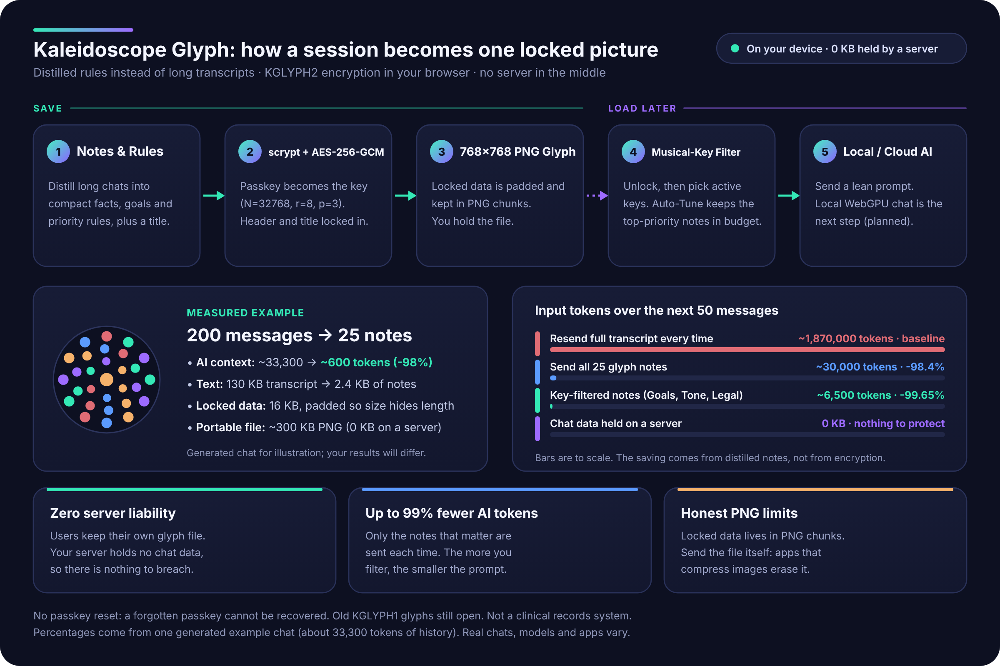

# Kaleidoscope Glyph (KGLYPH2)

Save your AI notes and rules as one small encrypted picture, then restore them later as a short prompt. Everything runs on your own device. No server, no account.

Two versions, fully compatible with each other:

| Version | How to run |
| :--- | :--- |
| `glyph.html` | Double-click to open in a browser. Works offline. Simple Mode for first-time users, with an Advanced drawer for keys, token budget and prompt preview. |
| `glyph.py` | `pip install cryptography pillow`, then `python glyph.py demo` (demo passkey: `demo-password`), `python glyph.py save notes.json`, `python glyph.py load file.png`. |

After editing any script in `glyph.html`, run `python update_csp.py glyph.html` to refresh its security hashes.

## Important to know
- **No passkey recovery.** Lose the passkey and the notes are gone. A 4-word passphrase is suggested.
- **Re-saving the PNG can erase the notes** (resize, screenshot, JPEG/WebP, many chat apps). Keep the original file.
- **The glyph is not smaller than your data.** The PNG is about 300 KB; the saving comes from sending short distilled notes to an AI instead of the whole chat.
- The browser cannot guarantee that memory is wiped. Use *Clear Session* and close the tab on shared computers.
- Not reviewed for healthcare or other regulated use.
- MIT license, provided AS IS.

Format details: [`docs/SPEC-kglyph2.md`](../../docs/SPEC-kglyph2.md).

